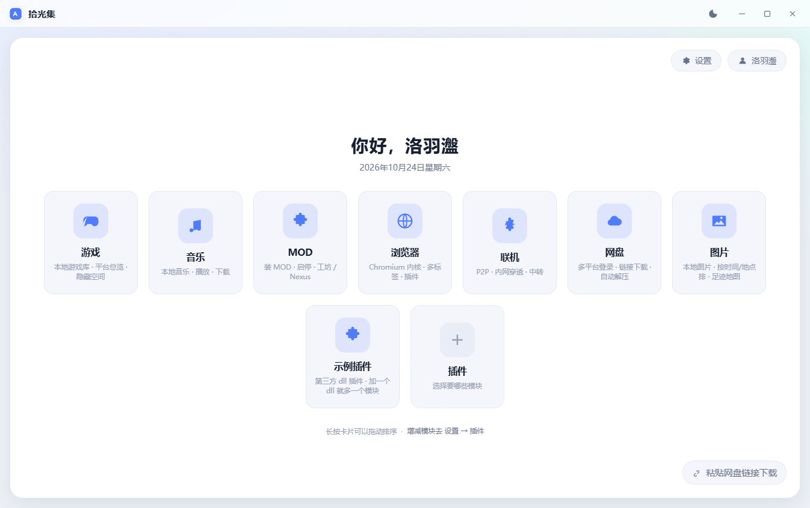
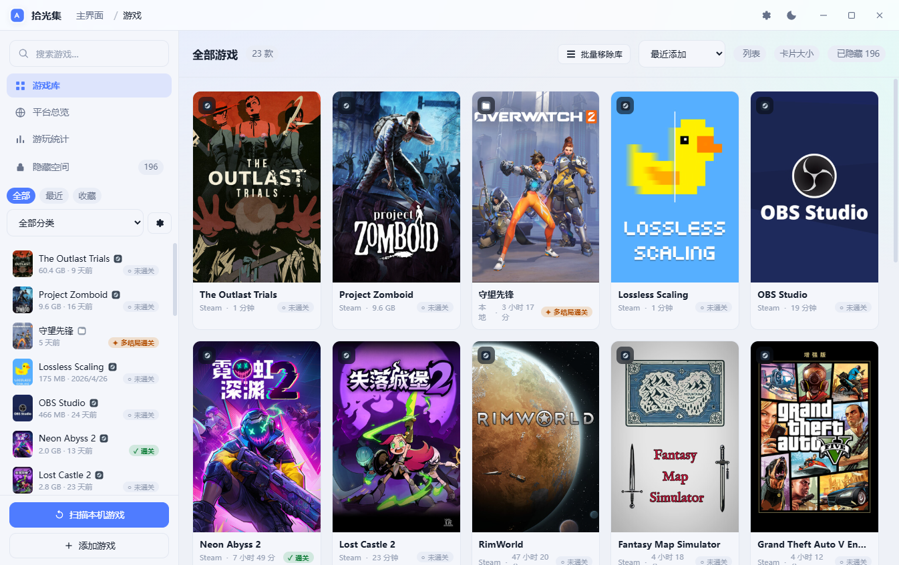
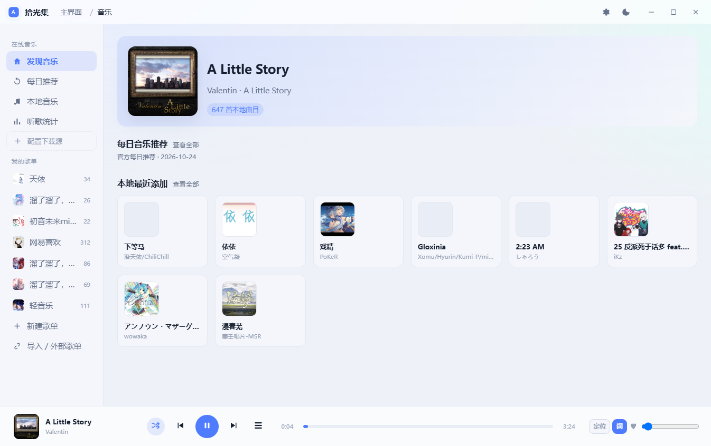
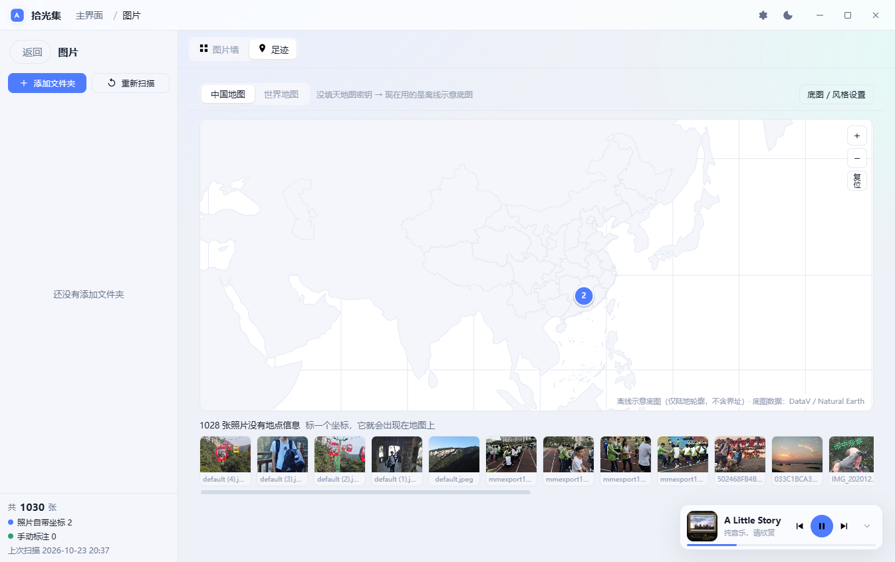
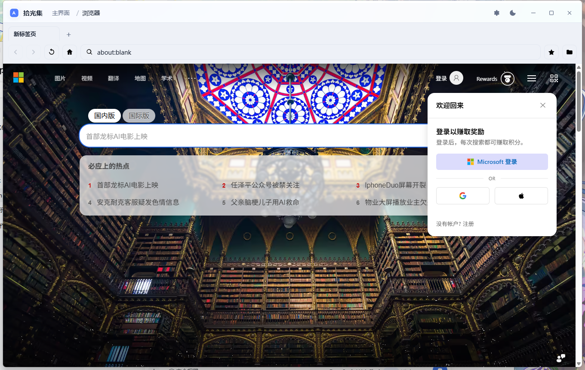
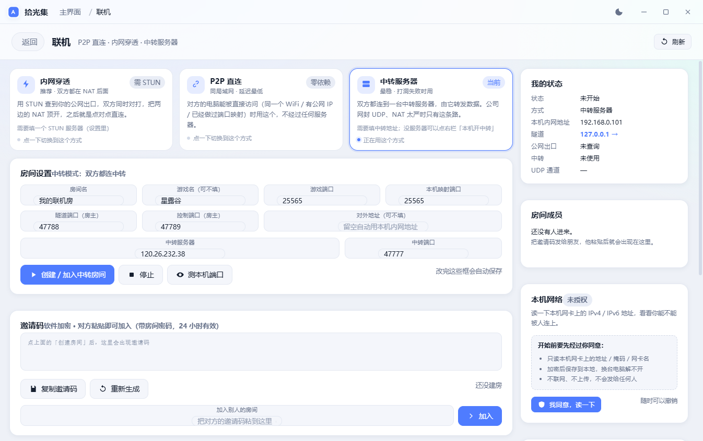

# 拾光集 · C 版（ShiGuangJi-C）

> 把原来的 Electron 版「拾光集」重做成 **C 程序**：主程序是一个 exe，七个模块各自编译成
> **独立的 dll**，主程序启动时扫描 `modules\*.dll` 动态加载。再加一个 dll，主界面就多一张卡。
>
> **1.0.0 正式版**（2026-10-24）｜ 0.4.0-c 为此前的测试版 ｜ Windows 10/11 x64 ｜ C11 ｜ WebView2
> ｜ 构建 **MSVC / Windows SDK** ｜ 无 npm、无 Node、无 Electron 运行时



---

## 一、先说清楚两件事（很重要）

### 1. 界面为什么还是 HTML/CSS/JS

原版的界面是 Electron 里的**一整套 HTML/CSS/JS**（3 千行 CSS、1.5 万行界面代码），
交互细节（长按拖卡片、封面回退链、迷你播放器、歌词页、图片墙、地图手势……）全在里面。
要做到「界面和交互不变」，C 版**原样复用这套前端资源**，由 `ShiGuangJi.exe` 内嵌的
WebView2 承载。

**变的是下面这些，全部是 C：**

| 原来（Electron） | 现在（C 版） |
|---|---|
| `main.js` 7167 行、257 个 IPC | `src/host/*.c` 宿主 + `src/modules/*/module.c` 各模块后端 |
| `preload.js` + Electron IPC | C 内置 HTTP 服务 + `/api` JSON 分发（前端仍调同一份 `SGJ.*`） |
| `src/main/{games,music,…}` Node 服务 | 七个 C dll（`games.dll` … `photos.dll`） |
| Electron 运行时 72 MB | 系统 WebView2（Win10/11 自带 Edge 内核） |
| 单文件便携 exe | `ShiGuangJi.exe` + `modules\*.dll`（界面资源已内嵌进 exe） |

也就是说：**主程序、模块加载、持久化、扫描、播放、网络、进程守护、地图数据、EXIF、
scrypt 密码校验……都是 C 写在 dll 里的；前端只负责画界面。** 这是「用 C 重写 Electron
应用、同时保持界面与交互不变」在工程上唯一现实的落法。

### 2. 功能对齐全景

七个模块**都能进、都能用**，核心功能已按原版行为实现；依赖第三方账号 / 在线资源 /
Electron 私有能力的少数功能是**明确标注的未完成项**，不会假装成功。详见
[`docs/功能对照.md`](docs/功能对照.md)。

---

## 二、目录结构

```
ShiGuangJi-C/
├── ShiGuangJi.exe            ← 构建产物（主程序，界面资源内嵌）
├── modules/                  ← 模块 dll（删一个就少一个模块）
│   ├── games.dll             游戏库 / 平台总览 / 游玩统计 / 隐藏空间 / MOD 数据
│   ├── mods.dll              MOD 模块界面
│   ├── music.dll             曲库 / 标签 / 封面 / LRC / 歌单 / 听歌统计
│   ├── netdisk.dll           链接识别 / 下载队列 / 断点续传 / 自动解压
│   ├── browser.dll           浏览器界面 + 书签 / 历史（网页画布由宿主提供）
│   ├── link.dll              TCP+UDP 端口映射 / 邀请码 / 房间聊天 / 网卡信息
│   ├── photos.dll            照片扫描 / EXIF / 缩略图 / 足迹地图数据
│   └── hello.dll             第三方 dll 插件示例
├── src/host/                 C 宿主（窗口、WebView2、HTTP、IPC、store、模块加载）
├── src/modules/              各模块 C 源码 + manifest + 界面资源
├── ui/                       共享前端资源（构建时压成 ui.zip 编进 exe）
├── third_party/              cJSON、WebView2 SDK
├── assets/app.ico            程序图标
├── docs/                     架构、模块 SDK、功能对照、截图
└── build.ps1                 一键构建
```

---

## 三、构建

### 环境

- Windows 10/11 x64
- **Visual Studio 2022 Build Tools**（MSVC 14.4x）+ **Windows SDK 10**
- **WebView2 Runtime**（Win10 1803+ / Win11 通常已随 Edge 安装；没有的话装
  [Evergreen Runtime](https://developer.microsoft.com/microsoft-edge/webview2/)）
- PowerShell 5.1 即可，不需要 Node / npm / Python

### 命令

```powershell
# 全量构建：exe + 8 个 dll + 内嵌 UI
powershell -ExecutionPolicy Bypass -File build.ps1

# 只重编某个 dll
powershell -ExecutionPolicy Bypass -File build.ps1 -NoHost -Only music

# 只编宿主
powershell -ExecutionPolicy Bypass -File build.ps1 -HostOnly
```

产物在 `build\`：

```
build\ShiGuangJi.exe
build\modules\*.dll
build\ui\            （开发态用；发布时可删，exe 走内嵌 UI_ZIP）
```

### 运行

```powershell
.\build\ShiGuangJi.exe
# 调试：开 WebView2 远程调试端口 9333（可用 Chrome DevTools 连）
.\build\ShiGuangJi.exe --dev
# 用一份独立的数据目录（不动真实库；测试/多开时用）
.\build\ShiGuangJi.exe --data-dir "D:\sgj-test"
```

数据目录默认是 `%APPDATA%\shiguangji\`，**和原 Electron 版是同一个**：
`shiguangji.json`、`covers\`、`music-covers\`、`photo-index.json`、`photo-thumbs\` 都能直接读。
⚠️ 不要同时开原版和 C 版（两边都会整库覆盖写）；换版本前先关掉另一个。

---

## 四、模块一览

### 游戏（games.dll）
- 扫描 Steam 库（`libraryfolders.vdf` + `appmanifest_*.acf`）、Epic 清单、注册表卸载项、
  常见游戏目录；按名称自动归类（25 类词表）
- 游戏库 CRUD、多分类、收藏、批量移除、封面（本地缓存优先 / Steam CDN 兜底）
- 启动 / 停止 / **进程守护计时**（本地 exe 用 `CreateProcess` + 等退出；`steam://` 协议按
  主程序名轮询进程）；游玩统计（周/月/季/年/全部）
- 平台总览（Steam 登录账号从 `config\loginusers.vdf` 读、客户端检测、库内统计）
- 隐藏空间：scrypt 密码（**和原版 `crypto.scryptSync` 参数完全一致**，老密码能直接解）、
  自动上锁、18+ 分类联动
- MOD：目录规则引擎（Bethesda / 巫师 / 赛博朋克 / 黑神话 / 帕鲁 / 我的世界…）、
  启停（`.disabled`）、导入（文件夹 / zip / tar / gz）、打包 zip、MOD 码、创意工坊



### MOD（mods.dll）
- 左栏选游戏、右侧 MOD 面板，界面与交互复用原版；数据 IPC 仍在 `games.dll`

### 音乐（music.dll）
- 递归扫描曲库，**按文件头魔数**认格式（MP3 / FLAC / M4A / OGG / Opus / WAV…），
  不看扩展名；ID3v2 / Vorbis Comment / MP4 atom 读标题、歌手、专辑，抽内嵌封面
- 封面缓存、空封面/死链自愈、LRC 库级递归匹配（同目录 / 同名 / 标题-歌手）
- 歌单 CRUD、导入 m3u/m3u8/pls/txt/json、导出 m3u8
- 播放交给 `<audio>`，音频走宿主的 `/local` 代理（**支持 Range**，FLAC 也能拖进度）
- 听歌统计（天桶、周/月/年、日历热力、唱片墙、单曲/音乐人 TOP、语言占比）



### 图片（photos.dll）
- 多文件夹递归扫描（jpg/jpeg/png/webp/gif/bmp/avif），跳过 `node_modules/.git/回收站`
- 自写 JPEG EXIF：拍摄时间、GPS、机型、方向；读不到时间退到文件修改时间
- WIC 按需生成缩略图并缓存；图片墙 / 大图 / 手动标地点（校验 ±90/±180、拒绝 0,0）
- 足迹地图：复用原版 Canvas 墨卡托引擎 + 内置离线轮廓；天地图 `tk` 由用户填



### 网盘（netdisk.dll）
- 12 家平台链接识别、提取码 / 解压码提取
- 下载队列（WinHTTP 流式写盘、**断点续传**、暂停/继续/取消）、进度事件
- zip/tar/gz 下载完自动解压（系统 `tar.exe`）
- 多账号 Cookie 存储结构（登录窗待接入，见「未完成」）

### 浏览器（browser.dll + 宿主）
- **真正能上网**：宿主里第二个 WebView2 画布，标签页 / 地址栏 / 前进后退 / 刷新 / 主页
- 书签、历史、搜索引擎、书签侧栏；侧栏收缩时画布自动重排
- 网页跑在系统 Edge 内核里，和系统浏览器同源能力



### 联机（link.dll）
- **TCP + UDP 双通道端口映射**：房主开隧道端口 → 本机游戏端口；加入方开本地端口 →
  房主隧道端口（游戏里填 `127.0.0.1:<本地端口>`）
- 邀请码（版本 + 主机 + 端口 + 有效期 + 校验，改一个字符就 `TAMPER`）
- 房间聊天（控制通道，消息不落盘）、本机网卡信息（需同意、只读本机、**不联网**）
- 端口可用性探测；中转服务端端口可用性（协议细节见「未完成」）



### 第三方 dll 插件（hello.dll）
- `modules\hello.dll` 一个文件里同时有：清单、界面 JS、C 后端
- 删掉它 → 主界面卡片和 `#/p/hello` 一起消失；放回来 → 重新出现
- 完整 ABI 和写插件的方法见 [`docs/模块SDK.md`](docs/模块SDK.md)

---

## 五、C 宿主怎么工作

```
┌──────────────────────────── ShiGuangJi.exe (C11) ────────────────────────────┐
│ Win32 窗口（无边框 / DPI 感知 / 最大化贴合工作区 / 单实例）                   │
│  ├─ WebView2 #1：应用界面（加载 http://127.0.0.1:<随机端口>/t/<token>/）      │
│  ├─ WebView2 #2：浏览器模块的网页画布（子窗口，按界面报告的矩形定位）         │
│  ├─ 内嵌 HTTP 服务（只绑 127.0.0.1，随机端口 + 32 位 token）                  │
│  │    GET  /            内嵌 UI（ui.zip → 首次解到 %LOCALAPPDATA%）          │
│  │    GET  /local/<p>   本地文件代理（图片 / 音频 / 缩略图，支持 Range）      │
│  │    GET  /mod/<id>/…  模块 dll 里内嵌的 renderer.js / style.css            │
│  │    POST /api        {channel,args[]} → 模块 / 宿主                        │
│  │    GET  /events      SSE，模块主动推事件（进度 / 状态）                    │
│  ├─ 模块加载器：LoadLibrary + sgj_module_entry + ABI 校验 + 频道前缀路由      │
│  ├─ JSON store：%APPDATA%\shiguangji\shiguangji.json（深合并、原子写、防抖）  │
│  └─ 宿主服务：文件/HTTP(WinHTTP)/对话框/进程/事件/本地 URL                    │
└──────────────────────────────────────────────────────────────────────────────┘
          │ LoadLibrary                         │ HTTP + SSE（同源，无跨域）
     modules/games.dll … photos.dll        WebView2 里的 HTML/CSS/JS（原版 UI）
```

- **前端 API 零改动**：`preload.js` 原样保留，桥接层伪造 `require('electron')`，
  把 `ipcRenderer.invoke` 变成 `POST /api`、`ipcRenderer.on` 变成 SSE。
- **C 侧并发**：每个 HTTP 连接一个线程；模块 `invoke` 串行（模块内部可自己起线程，
  如 netdisk 下载、games 进程守护、link 转发）。
- **数据兼容**：老库直接读；未知字段原样保留；写盘用临时文件 + `MoveFileEx` 原子替换。

---

## 六、和原版的差别（诚实清单）

### 已实现（可直接用）
游戏扫描/CRUD/启动计时/统计/分类/隐藏空间/MOD 规则、音乐扫描/标签/封面/歌词/歌单/统计/播放、
图片扫描/EXIF/缩略图/地图/标点、网盘识别/下载/续传/解压、联机端口映射/邀请码/聊天/网卡、
浏览器真实上网/标签/书签/历史、插件 dll 加载、主题/外观/插件开关/更新检查。

### 未完成 / 与原版有差距
| 功能 | 现状 | 原因 |
|---|---|---|
| 音乐每日推荐、在线歌单、下载源抓取 | 设置项可存，执行会明确报「未接入」 | 依赖平台登录 Cookie 与站点接口 |
| 网盘平台登录窗 | 未接入（按钮会报错） | 需要在 WebView2 里抓 Cookie 并回写 |
| 浏览器查找/阅读模式/手势/广告过滤/截图 OCR/扩展 | 未移植 | 原版依赖 Electron `<webview>` 私有 API |
| 联机中转协议 / STUN 打洞 | 端口映射可用；中转只起监听端口 | 中转帧协议需与 Node 版逐字节对齐 |
| 虚拟局域网（wintun） | 界面如实显示不可用 | 需要驱动 + FFI + 管理员权限 |
| Steam 成就同步、完整库内（未安装）列表 | 账号/已安装列表已读，成就未同步 | 需要 Steam Web API / localconfig 深解析 |
| 听歌统计海报导出 | 未接 | 需要 WebView2 CapturePreview + 保存 |
| 自动更新下载替换 | 只检查 + 打开下载页 | 和原版一致：刻意不自动替换 |

> 这些缺口都在 [`docs/功能对照.md`](docs/功能对照.md) 里逐条对应到原版文件，
> 方便后续继续补。

---

## 七、开发与测试

- 单测：C 版目前以**真机端到端**为主（启动 exe → WebView2 远程调试 → 逐页截图 + API 断言）。
  这一轮实际跑过：8 个 dll 加载、23 款游戏列表、647 首曲库、1030 张照片、
  FLAC 播放（含 Range 拖动）、LRC 匹配、图片地图、netdisk 真实下载、
  联机建房/邀请码/停止、插件开关、隐藏空间 scrypt 校验、内嵌 UI 解压。
- 调试：`--dev` 会打开 `http://127.0.0.1:9333/json`，可直接用 Chrome DevTools 连
  `WebView2` 的两个页面（应用界面 / 浏览器画布）。
- 日志：`%LOCALAPPDATA%\ShiGuangJi-C\logs\app.log`。

---

## 八、许可

MIT，见 [LICENSE](LICENSE)。原项目：`github.com/luoyupan/ShiGuangJi`。
